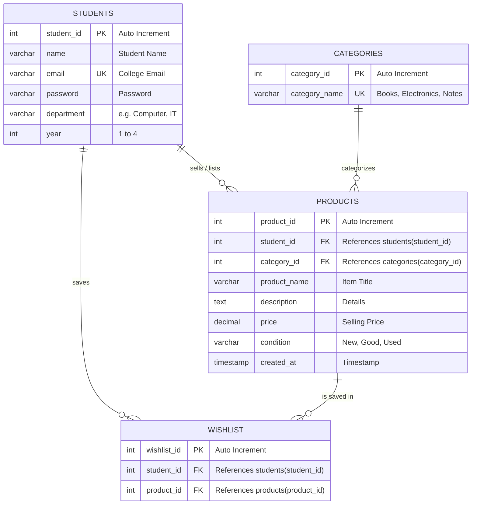

# 🎓 Smart Campus Marketplace

A full-stack, peer-to-peer campus marketplace designed for university students to buy, sell, and wishlist pre-owned campus essentials—including textbooks, electronics, notes, and hostel supplies—powered by **React**, **Node.js/Express**, and a cloud **MySQL** database.

---

## 🌟 Key Features

- **🛒 Student-Centric Trading**: Buy and sell secondhand textbooks, lab coats, calculators, and hostel essentials directly within the campus community.
- **🏷️ Real-time Category Filtering**: Quickly browse through categories like *Books*, *Electronics*, *Notes*, and *Hostel Essentials*.
- **❤️ Personal Wishlist**: Save items of interest to your private wishlist for quick tracking.
- **⚡ Fast Search & Live Updates**: Instant search across item titles, seller names, departments, and price ranges.
- **📊 Visual Database Explorer**: Integrated live dashboard (`/db`) to inspect relational tables and execute custom queries.
- **🔒 Relational Data Integrity**: Fully normalized MySQL schema with foreign keys, cascading deletions, unique constraints, and ACID transactions.

---

## 🛠️ Tech Stack

| Layer | Technology | Description |
| :--- | :--- | :--- |
| **Frontend** | React 19 + Vite | Fast, responsive single-page application with modern UI |
| **Styling** | Custom CSS | Clean, modern campus theme with mobile and desktop support |
| **Backend** | Node.js & Express.js | Scalable REST API architecture handling CRUD operations |
| **Database** | MySQL (Cloud Aiven / Local) | Relational database with full normalization and indexing |
| **Database Driver** | `mysql2/promise` | Connection pooling with SSL support |

---

## 📊 Database Architecture

The system is designed with a 3NF normalized schema across **four core relational tables**:



---

## 🔄 REST API Endpoints

| Entity | Method | Endpoint | Description |
| :--- | :--- | :--- | :--- |
| **Students** | `POST` | `/api/students/register` | Register a new student |
| | `GET` | `/api/students` | Get all students |
| | `GET` | `/api/students/:id` | Get student by ID |
| **Products** | `GET` | `/api/products` | Retrieve all listed items |
| | `POST` | `/api/products` | Post a new item for sale |
| | `PUT` | `/api/products/:id` | Update product details |
| | `DELETE` | `/api/products/:id` | Remove a product listing |
| **Categories** | `GET` | `/api/categories` | Fetch all product categories |
| | `POST` | `/api/categories` | Add a new category |
| **Wishlist** | `GET` | `/api/wishlist/:student_id` | Fetch wishlist items for a student |
| | `POST` | `/api/wishlist` | Bookmark a product to wishlist |
| | `DELETE` | `/api/wishlist/:student_id/:product_id` | Remove an item from wishlist |
| **System** | `GET` | `/api/health` | Health check endpoint |
| | `GET` | `/db` | Visual database console |

---

## 🚀 Getting Started

### Prerequisites
- [Node.js](https://nodejs.org/) (v18+)
- [MySQL](https://www.mysql.com/) (Local or Cloud instance)

### Installation

1. **Clone the repository:**
   ```bash
   git clone https://github.com/payalpawar1320-afk/Smartcampus_marketplace.git
   cd Smartcampus_marketplace
   ```

2. **Install dependencies:**
   ```bash
   npm install
   ```

3. **Configure Environment Variables:**
   Create a `.env` file in the root directory:
   ```env
   PORT=5000
   DB_HOST=localhost
   DB_USER=root
   DB_PASSWORD=your_password
   DB_NAME=smart_campus_marketplace
   DB_PORT=3306
   DB_SSL=false
   ```

4. **Initialize Database:**
   Execute `database/schema.sql` and `database/seed.sql` in your MySQL database.

5. **Run the Application:**
   ```bash
   npm run dev
   ```
   - **Frontend**: `http://localhost:5173`
   - **Backend API**: `http://localhost:5000`
   - **Database Console**: `http://localhost:5000/db`

---

## 📦 Production Build

To build the optimized production assets:
```bash
npm run build
npm start
```

---

## 📄 License
This project is open source and available under the [MIT License](LICENSE).
